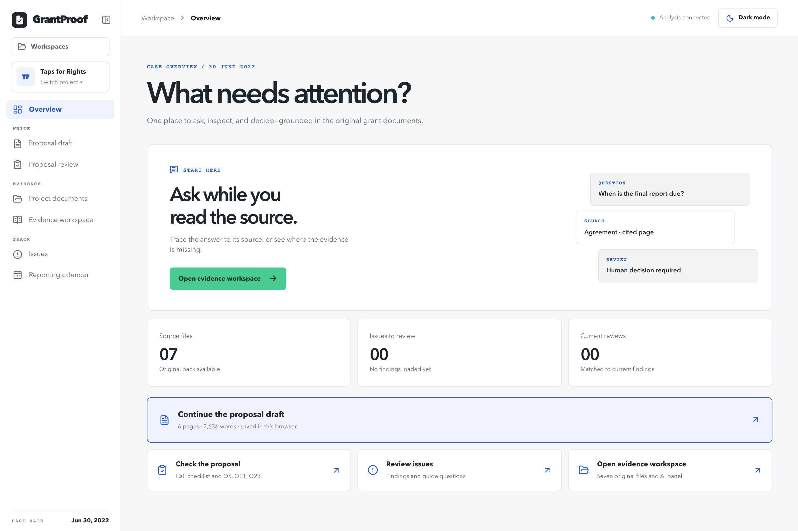
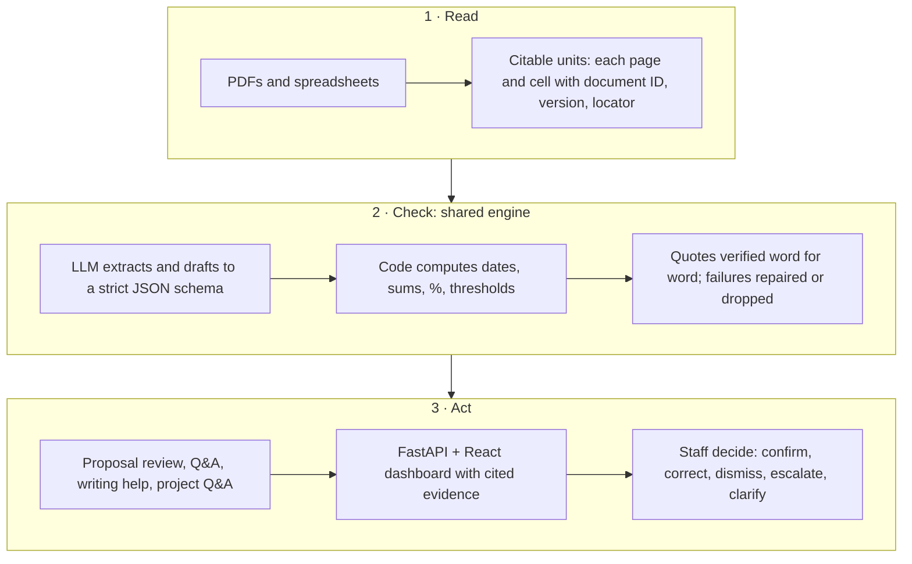

# GrantProof

**An evidence-first assistant for grant compliance.** GrantProof reads a grant's documents side by side (the funding call, the proposal, the contribution agreement, results reports, the logic model and the budget), flags what doesn't line up, and cites the exact page behind every finding. Staff make every decision.



> **Status:** working prototype, built for The Water Challenge (WaterAid Canada × The AI Fellowship × SOON × TMU), Challenge A6. "GrantProof" is a working name. The bundled case, Water Care's *Taps for Rights* project funded by Global Affairs Canada (GAC), is fictional training material seeded with deliberate errors. It is not real WaterAid activity.

## Why

Grant compliance is mostly manual cross-checking. Every reporting cycle, staff compare long documents clause by clause, and a missed obligation or a mismatched date can put funding at risk. Those hours come out of pursuing new grants, and smaller grants cost almost as much to administer as large ones. GrantProof does the reading and cross-checking, shows its evidence, and leaves the judgement to people.

## What it does

| Area | What staff can do |
| --- | --- |
| **Proposal review** | Check a proposal against the funding call: cost share, construction limits, unsupported claims, and a requirements checklist. GAC reviewer questions are mapped to the proposal sections that answer them. |
| **Ask across documents** | Ask any question. Answers quote the page they rely on and show confidence, conflicting evidence, missing information and the next action. When sources conflict, they name who decides: GAC or staff. |
| **Proposal draft** | Write in an editor with the funder's template or the imported case proposal. The review desk gives cited tips and ready-to-edit sentences, and unknown facts stay as `[placeholders]`. Undo/redo and print to PDF are included. |
| **Evidence workspace** | Every citation opens the original PDF at the cited page with the quote highlighted, next to a question panel. |
| **Issues and decisions** | Confirm, correct, dismiss, escalate or request clarification on each finding. A decision is marked stale when its evidence changes. |
| **Reporting calendar** | See report due dates around the case date (30 June 2022), with links to the clauses that set them. |
| **Projects** | Create, rename and delete projects, upload PDFs, spreadsheets and CSVs to each, and ask grounded questions about them. |

## How it keeps findings trustworthy

1. **Every finding cites its source**: document, version, and page or sheet and cell.
2. **Quotes are verified.** A quote that doesn't appear word for word in the cited source is rejected, never shown as evidence.
3. **Code does the math.** Dates, sums, percentages and thresholds are computed in Python, never by the model.
4. **Conflicts are named, not settled.** Both sides are shown, along with who should resolve it.
5. **Missing documents are known.** Referenced documents that aren't in the pack, such as GAC's General Terms and Conditions, are registered as absent, so the tool says "not in the documents" instead of guessing.
6. **People decide.** The AI drafts and flags; it never approves or submits anything.

## How it works



The model runs through OpenRouter and is tiered by task: GPT-4.1 mini for routine extraction and writing help, GPT-4.1 for harder comparisons. Both can be changed in `.env`. Without a key, the backend and its tests run against a built-in fake model.

## Tech stack

| Layer | Tools |
| --- | --- |
| Backend | Python 3.13, FastAPI, Uvicorn, Pydantic, pypdf, openpyxl, uv |
| AI | OpenRouter (GPT-4.1 / GPT-4.1 mini by default) |
| Frontend | React 19, TypeScript, Vite, Tailwind CSS, react-pdf (PDF.js), zod, Lucide |
| Testing | pytest (200+ tests, offline), Playwright for browser checks |

## Getting started

**Prerequisites:** Python 3.13 with [uv](https://docs.astral.sh/uv/), Node.js 22 or newer, and an [OpenRouter](https://openrouter.ai/) API key for the AI features. The interface and the source documents work without a key.

```bash
git clone https://github.com/M-harib/wateraid.git
cd wateraid
cp backend/.env.example backend/.env   # then set OPENROUTER_API_KEY
make install                           # uv sync + npm install
make up                                # backend :8010, frontend :5173
```

Open <http://localhost:5173>. `make status` shows what's running, `make logs` follows both logs, and `make down` stops both. Use `make be` or `make fe` to run one side in the foreground with live reload.

<details>
<summary>Without make</summary>

```bash
# terminal 1
cd backend && uv sync && uv run uvicorn api.main:app --port 8010
# terminal 2
cd frontend && npm install && VITE_API_BASE_URL=http://localhost:8010 npm run dev
```
</details>

**Tests**

```bash
cd backend && uv run pytest -q     # no API key needed
cd frontend && npm run build       # type-check and production build
```

## Project structure

```text
backend/
  api/      FastAPI app and the JSON contract for the frontend
  core/     ingestion, source registry, quote verifier, deterministic checks, LLM client
  tools/    proposal, compliance and per-project assistants, writing help
  tests/    unit tests and the 25-question evaluation scaffold
  assets/   the challenge source pack (fictional case)
frontend/   React dashboard (src/components, src/api.ts, src/product.ts holds the app name)
docs/       architecture, decisions, brand guide, handoff log, screenshots
Makefile    install, up, down, status, logs
```

## Main API routes

| Route | Purpose |
| --- | --- |
| `POST /proposal/run`, `GET /proposal/run/status` | Run the proposal review in the background and track its progress |
| `GET /proposal` | Proposal findings, call checklist and reviewer-question mapping |
| `POST /proposal/ask` | Cited Q&A across the source pack |
| `POST /proposal/writing-help` | Cited tips and draft sentences for one proposal page |
| `GET /findings`, `POST /ask` | Compliance findings and Q&A |
| `GET/POST /projects`, `PATCH/DELETE /projects/{id}` | Create, list, rename and delete projects |
| `POST /projects/{id}/documents`, `POST /projects/{id}/ask` | Upload documents to a project and ask about them |

## Status and roadmap

**Built:** citation-checked findings, proposal review, cross-document Q&A, the proposal editor with cited writing help, the PDF evidence view, per-project uploads, staff decisions, a reporting calendar, and light and dark themes.

**In progress:**

- **Evaluation.** The scorer for the 25 test questions in the participant guide is built; the expected answers are being written, so no accuracy figure is published yet.
- **Reporting calendar data.** The calendar uses a sample schedule generated from the agreement until the obligations register lands.

**Next:**

- **Requirements register.** Every obligation from agreements and amendments, with computed and stated due dates side by side.
- **Evidence tracking.** Link each requirement to the reports and approvals that satisfy it.
- **Accounts and audit trail.** Shared review history and audit-ready exports. Drafts and decisions are browser-local today.
- **Pilot with WaterAid staff.** Measure review time and recall against staff's own checks.

## Team

Team Reef:

- Mike Dohyun Lim ([@mikeylim](https://github.com/mikeylim))
- Mohammed Ali Zubair ([@Alig1493](https://github.com/Alig1493))
- Muhammad Harib Chaudhry ([@M-harib](https://github.com/M-harib))
- Brian Hickling ([@bhickling007](https://github.com/bhickling007))
- Gorbi Ahmed

## More documentation

- [`AGENTS.md`](AGENTS.md): build rules and source-pack guide
- [`docs/ARCHITECTURE.md`](docs/ARCHITECTURE.md) and [`docs/DECISIONS.md`](docs/DECISIONS.md)
- [`docs/BRAND.md`](docs/BRAND.md): visual and voice guide
- [`docs/HANDOFF.md`](docs/HANDOFF.md): change log with verification notes
- [`backend/tools/proposal/README.md`](backend/tools/proposal/README.md) and [`backend/tests/eval/README.md`](backend/tests/eval/README.md)

## License

No license has been chosen yet. Please contact the team before reusing this code.
